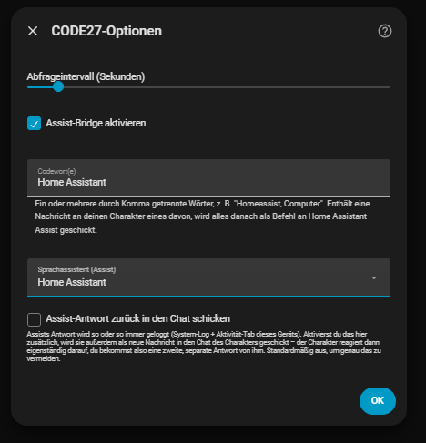

🇩🇪 [Deutsch](README.md) | 🇬🇧 English

# HASE – Home Assistant Spellbook Engine


HASE combines a device-independent Spellbook Engine with optional companion providers.

Standalone agents do not require a CODE27 device. CODE27 is the first provider to add device features, a chat bridge, and satellite subentries.

**Rebrand requires a fresh setup:** The Home Assistant domain is now `hase`. Existing `code27` entries are not migrated. Before switching, create a backup, remove the old entries while the previous integration is still installed, and then set up HASE from scratch. There are no legacy aliases for services, events, or paths.

See [Cutover and Live Validation](docs/HASE-CUTOVER.md) and [Architecture](docs/HASE-ARCHITECTURE.md).
A fourth frontend, MCP (Model Context Protocol — external agents/LLM tools call Spells
directly), is documented in [MCP interface](docs/HASE-MCP.md); for building your own Bridge/
frontend adapter see [Adding new Bridges](docs/HASE-NEW-BRIDGES.md).

## Contents

* [Agents: Spellbookers & Satellites](#agents-spellbookers--satellites)

  * [Standalone Spellbooker (no CODE27 device required)](#standalone-spellbooker-no-code27-device-required)
  * [Satellite (subentry attached to a CODE27 device)](#satellite-subentry-attached-to-a-code27-device)
* [Installation](#installation)
* [CODE27 Provider](#code27-provider)

  * [Requirements](#requirements)
  * [Setup (step by step)](#setup-step-by-step)
  * [What gets created?](#what-gets-created)
  * [Configuring options](#configuring-options)
  * [Services](#services)
  * [Events](#events)
  * [Assist Bridge – Voice commands through character chat](#assist-bridge--voice-commands-through-character-chat)

    * [Two-stage command cleanup (optional)](#two-stage-command-cleanup-optional)
    * [Proven voice patterns (Assist grammar)](#proven-voice-patterns-assist-grammar)
    * [Spellbooks – fixed incantations](#spellbooks--fixed-incantations)
    * [Vacuum Area Resolver](#vacuum-area-resolver)
  * [Dashboard Card (code27-card)](#dashboard-card-code27-card)
  * [Intentional design decisions](#intentional-design-decisions)
  * [Known limitations](#known-limitations)
  * [Technical background](#technical-background)
* [Support & Issues](#support--issues)

## Agents: Spellbookers & Satellites

Under **Settings → Devices & services → Add integration → HASE**, there are two independent ways to create an agent: pair a CODE27 device (see [CODE27 Provider](#code27-provider) below), or create a standalone **Spellbooker** voice assistant that does not require a device.

A third option — a **Satellite** — can be added later to an existing CODE27 device. A standalone Spellbooker requires no CODE27 device, while a Satellite is attached to an existing one. The pairing procedure, device entities, services, events, Assist Bridge, and dashboard card described throughout the rest of this document apply exclusively to the CODE27 provider.

### Standalone Spellbooker (no CODE27 device required)

**Add integration → HASE → Create Spellbooker voice assistant** creates a pure Conversation Agent that understands only commands defined in a Spellbook — without CODE27 hardware, a chat-bridge detour, or backend fallback.


*(Placeholder – screenshot of the "Connect CODE27 device" / "Create Spellbooker voice assistant" selection menu to follow.)*

| Field                                          | Description                                                                                                               |
| ---------------------------------------------- | ------------------------------------------------------------------------------------------------------------------------- |
| Name                                           | Title of the entry and name of the resulting `conversation.*` entity                                                      |
| Spellbook                                      | One of the books from `custom_components/hase/spellbooks/` or `<config>/hase_spellbooks/`                                 |
| Allowed areas (actions) / Unrestricted actions | Defines the areas in which this assistant may execute actions; "unrestricted" allows all areas and ignores the selection  |
| Allowed areas (queries) / Unrestricted queries | Independent of the action areas: defines the areas for which status queries (e.g. "how warm is it in X?") may be answered |
| No-match response                              | Spoken when a sentence does not match any Spellbook command. Empty = default response                                     |


*(Placeholder – screenshot of the Spellbooker setup form to follow.)*

For both actions and queries, either at least one area must be selected or the corresponding "unrestricted" option must be enabled.

The Spellbooker appears as its own entry under **Devices & services** — no device and no additional entities apart from the Conversation entity itself — and can be added to an Assist pipeline under **Settings → Voice assistants**, just like any other voice assistant.

Its options (Spellbook, areas, and no-match response) can be changed at any time via **Configure**.

### Satellite (subentry attached to a CODE27 device)

⚠️ **Experimental:** A Satellite first tries its own Spellbook. If there is no match, it forwards the request to an actual character conversation on the associated CODE27 device.

The response correlation on the device — determining which response belongs to which request — has not been tested while the physical device is being used for chat at the same time. Do not use this where an incorrect or delayed response could cause a real problem.

On an already configured CODE27 entry, open its subentry menu and select **Add Satellite**:


*(Placeholder – screenshot of the subentry menu on the CODE27 device entry to follow.)*

| Field                                          | Description                                                                                                                               |
| ---------------------------------------------- | ----------------------------------------------------------------------------------------------------------------------------------------- |
| Name                                           | Name of the Satellite; appears as its own "device" below the CODE27 device (e.g. "CODE27 Papa" → "Lilya Satellite")                       |
| Character slot                                 | Number of the character slot on the device that the Satellite talks to (the same number used by the device's own character-slot selector) |
| Spellbook                                      | Optional; "— No local Spellbook —" sends every utterance directly to the CODE27 backend (character chat)                                  |
| Allowed areas (actions) / Unrestricted actions | Applies both to the local Spellbook **and** to anything proposed by the CODE27 backend                                                    |
| Allowed areas (queries) / Unrestricted queries | Independent of the action areas                                                                                                           |
| No-match response                              | Only relevant when no Spellbook is selected. If a Spellbook is selected, a no-match is always forwarded to the device character instead   |


*(Placeholder – screenshot of the Satellite setup form to follow.)*

A Satellite shares its Coordinator and backend lock with its CODE27 device and does not create its own top-level entry. It remains permanently attached to the specific device on which it was created.

Existing Satellites can be changed through their own subentry menu (**Reconfigure Satellite**). Any change reloads the complete CODE27 entry.

## Installation

1. Copy the `custom_components/hase` folder into the `custom_components` directory of your Home Assistant configuration (`<config>/custom_components/hase`).
2. **Fully restart Home Assistant** — do not just reload the integration. New integrations and, importantly for later updates, newly added entities are reliably picked up by this type of integration only after a full restart.

This applies regardless of whether you then configure a standalone Spellbooker, a Satellite, or a CODE27 device — all three live inside the same `custom_components/hase`.

## CODE27 Provider

Everything from this point onward — pairing, device entities, options, services, events, the Assist Bridge, and the dashboard card — belongs exclusively to the **CODE27 Provider** and requires a CODE27 device.

None of it is required for a standalone Spellbooker or Satellite (see [Agents: Spellbookers & Satellites](#agents-spellbookers--satellites) above).

The screenshots show the integration under its former CODE27 appearance; in the current integration dialog it is named HASE.

The CODE27 Provider connects your CODE27 device (Web UI at `http://<ip>:8081`, internally called **CODIE**) through the device's **own local REST and WebSocket API** — exactly the same protocol used by the device's own web interface. Nothing has been invented that the device does not already expose.

A matching **dashboard card** (`code27-card`) provides chat, light/music controls, alarms, notes, and a live feed of the voice bridge.

### Requirements

* A CODE27 device on the same local network as Home Assistant, reachable at `http://<ip>:8081`.
* A reasonably recent Home Assistant version (the Assist Bridge uses `conversation.async_converse` and `ConversationAgentSelector`).
* For the optional Assist Bridge: a configured Assist voice assistant in Home Assistant.

### Setup (step by step)

#### 1. Add the integration

Go to **Settings → Devices & services → Add integration**, search for **HASE**, then select **Connect CODE27 device**.


Enter the local IP address of your CODE27 device (e.g. `192.168.xxx.xxx`) and the port (`8081`).


#### 2. Pairing

A 6-digit pairing code now appears on the **CODE27 device's own screen**.

This is the device pairing screen and does not require a login — it is the same process used when connecting a new browser to the device.


Enter this code in Home Assistant:


Home Assistant receives **its own persistent local secret**, independent of any browser session you otherwise use with the device — effectively as if HA were its own "device" in the CODE27 app.

#### 3. Done

The integration now creates a device with all entities listed below and immediately starts polling.


### What gets created?

Everything is attached to one device ("CODE27 (<host>)") in Home Assistant:

| Entity                                                                       | Type            | Description                                                                                                                                                                                                                          |
| ---------------------------------------------------------------------------- | --------------- | ------------------------------------------------------------------------------------------------------------------------------------------------------------------------------------------------------------------------------------ |
| Music                                                                        | `media_player`  | Play/Pause/Next/Previous, volume, source (TF card/Bluetooth), title, position/duration                                                                                                                                               |
| Ambient color                                                                | `light`         | Free RGB color + brightness + effect (Static/Breathe/Pulse/Blink/Running Light) through the Light Editor's preview channel. Not persistent and does not overwrite saved projects. On/Off mirrors the device-wide light master switch |
| Light scene                                                                  | `select`        | Selects a light scene saved in the Light Editor and applies it (`apply`, persistent)                                                                                                                                                 |
| Active character                                                             | `select`        | Switches the active character slot                                                                                                                                                                                                   |
| Alarm *(per alarm)*                                                          | `switch`        | On/Off for each alarm configured on the device, including time/repetition as attributes                                                                                                                                              |
| Notes & Reminders                                                            | `todo`          | Create/edit/delete list mirrored from "Lab → Notes & Reminders". **No** "completed" state — the device itself only supports deletion, not checking items off                                                                         |
| Music mode active                                                            | `binary_sensor` | Whether the music page is currently open on the device screen                                                                                                                                                                        |
| Notification active                                                          | `binary_sensor` | Whether a blinking notification triggered through `hase.notify` is currently active                                                                                                                                                  |
| Acknowledge notification                                                     | `button`        | Stops the currently active notification alarm                                                                                                                                                                                        |
| Last said (you) / (character)                                                | `sensor`        | Most recent chat message separated by role. The character sensor additionally contains the last ~30 messages in its `history` attribute (used by the card)                                                                           |
| Active character / Active alarms / Notes / Language / Time zone / Build type | `sensor`        | Diagnostic and status values                                                                                                                                                                                                         |
| Play test sound / Stop sound                                                 | `button`        | Device test without going through the device UI                                                                                                                                                                                      |

A standalone Spellbooker or Satellite creates **none** of these entities — only its own `conversation.*` entity (see [Agents: Spellbookers & Satellites](#agents-spellbookers--satellites)).

### Configuring options

**Settings → Devices & services → HASE → Configure** opens the options dialog containing the polling interval and Assist Bridge settings:



| Field                                | Description                                                                                                                                                                                                                                        |
| ------------------------------------ | -------------------------------------------------------------------------------------------------------------------------------------------------------------------------------------------------------------------------------------------------- |
| Polling interval                     | Safety-net polling for alarms/notes/character/system (default 15s). Music and light status arrive independently via WebSocket push in near real time, while chat is polled separately every 3s (see [Technical background](#technical-background)) |
| Enable Assist Bridge                 | Enables/disables the voice bridge to Home Assistant Assist                                                                                                                                                                                         |
| Codeword(s)                          | One or more comma-separated words, e.g. `Homeassist, Computer`                                                                                                                                                                                     |
| Spellbook                            | Optional; fixed incantations instead of codeword + free text — see [Spellbooks](#spellbooks--fixed-incantations)                                                                                                                                   |
| Spellbook mode                       | Only relevant when a Spellbook is selected: "Fallback to codeword" additionally checks the codeword if no trigger matches; "Spellbook only" ignores everything else                                                                                |
| "Did you mean...?" for unknown names | Actively asks for clarification when an area/device name cannot be resolved instead of merely returning the Assist error                                                                                                                           |
| Acknowledgement phrase(s)            | One or more comma-separated phrases that acknowledge an active notification alarm, just like the acknowledgement button, e.g. `Acknowledge alarm`                                                                                                  |
| Voice assistant                      | Optional; empty = built-in `conversation.home_assistant` agent, **not** necessarily the assistant selected as your preferred one under Settings → Voice assistants                                                                                 |
| Send Assist response back            | **Off** by default — see [Assist Bridge](#assist-bridge--voice-commands-through-character-chat)                                                                                                                                                    |
| Speak response aloud                 | Speaks Assist's response (or a Spellbook catchphrase) through the device's TTS preview using the active character's voice                                                                                                                          |
| Enable AI cleanup                    | Optional: lets an `ai_task` entity (e.g. a local Ollama model) rewrite the command before sending it to Assist — see [Two-stage command cleanup](#two-stage-command-cleanup-optional)                                                              |
| AI Task entity                       | Selects the `ai_task` entity used for cleanup                                                                                                                                                                                                      |
| Enable vacuum action                 | **Off** by default; allows Spellbook commands using `operation: vacuum.clean_area` to trigger actual room-specific cleaning — see [Vacuum Area Resolver](#vacuum-area-resolver)                                                                    |

The polling interval is stored **per device** (Config Entry). If you have multiple CODE27 devices, each one has its own options.

### Services

All services target an existing CODE27 device via `config_entry_id` and are not available to standalone Spellbookers or Satellites.

| Service                  | Description                                                                                                                                                                |
| ------------------------ | -------------------------------------------------------------------------------------------------------------------------------------------------------------------------- |
| `hase.create_alarm`      | Create a new alarm (time, weekdays, label, enabled state)                                                                                                                  |
| `hase.update_alarm`      | Modify an existing alarm using its `alarm_id`                                                                                                                              |
| `hase.delete_alarm`      | Delete an existing alarm using its `alarm_id`                                                                                                                              |
| `hase.speak`             | Output text through the active character's TTS preview                                                                                                                     |
| `hase.send_chat_message` | Sends text into the character chat as if you had typed it yourself                                                                                                         |
| `hase.notify`            | Makes the LEDs blink in a selected color until acknowledged — useful for alarms from e.g. Node-RED. Fields: `message` (logged only, not spoken), `rgb_color` (default red) |
| `hase.notify_clear`      | Programmatically stops the blinking notification instead of using the button                                                                                               |

### Events

These events are also emitted only for a CODE27 device (chat with its character), not for standalone Spellbookers or Satellites.

| Event                    | Payload                                                    | When                                            |
| ------------------------ | ---------------------------------------------------------- | ----------------------------------------------- |
| `hase_user_message`      | `text`, `chat_id`, `slot`, `created_at`, `config_entry_id` | For every new message you send to the character |
| `hase_assistant_message` | same as above                                              | For every new response from the character       |

This allows you to build your own automations independently of the built-in bridge:

```yaml
alias: "CODE27: custom automation on command"
trigger:
  - platform: event
    event_type: hase_user_message
condition:
  - condition: template
    value_template: "{{ 'good night' in trigger.event.data.text | lower }}"
action:
  - service: script.good_night_routine
```

### Assist Bridge – Voice commands through character chat

CODE27 itself currently has **no** function-calling/tool system that would allow the character to control devices directly. No such interface exists in the device UI's web bundle.

What the device does provide, however, is a clean chat history in which every message is clearly separated by `role: "user"` and `"assistant"`. The bridge is built on top of that.

Instead of intercepting individual phrases through custom automations, the bridge forwards everything after the codeword **1:1 to Home Assistant Assist** using `conversation.async_converse`.

That means it can use essentially anything your Assist understands — not just lights.

Every step is **traceable live** in the system log and as a logbook entry in the device's Activity tab:

```
Codeword detected, command: "what time is it?"
Sent to Assist: "what time is it?"
Assist response: "It is 12:51"
Response sent to chat   (only if "Send response back" is enabled)
```

Enable **Send Assist response back** only if you want the character to **react to the response again on its own**.

Assist's response is then inserted as a new chat message, and the character responds to it independently. This is not 1:1 speech output — there is no API that allows putting exact words into the character's mouth.

The option is disabled by default because otherwise it tends to feel like an unsolicited duplicate response.

#### Two-stage command cleanup (optional)

A character is not usually addressed like a smart speaker. Conversations tend to be more roleplay-like, for example:

"Hey, could you maybe ask Home Assistant whether it could set the desk light to 80 percent if it wouldn't mind?"

instead of a concise command.

Assist's own NLU expects more direct wording and may fail when given too much conversational padding. The bridge therefore cleans up the text in two stages before passing it to Assist:

1. **Stage 1 – Regex filter (always active, free):** Removes common filler phrases such as "could you please...", "would you ask whether...", or "...if it wouldn't mind" using regular expressions. Runs locally in Python, requires no configuration and no model.
2. **Stage 2 – AI cleanup (optional, via `ai_task`):** For cases Stage 1 does not fully handle, an `ai_task` entity (e.g. a local Ollama model) can reduce the remaining text to a short command such as "Desk light 80 percent". If the AI request fails for any reason (model unavailable, error, etc.), the Stage 1 result is simply used instead. The bridge never fails because of the AI cleanup stage.

Both stages are included in the Activity log:

```
Codeword detected, command: "hey, could you maybe ask whether it could
set the ambient color to 80 percent if it wouldn't mind?"
Filler removed: "set the ambient color to 80 percent"
AI cleanup: "Ambient color 80 percent"
Sent to Assist: "Ambient color 80 percent"
Assist response: "Brightness set"
```

**Hardware requirements for Stage 2:** A very small model is entirely sufficient.

Tested with `qwen3:0.6b` through the local Ollama add-on, **CPU-only** (no GPU passthrough), on a used ThinkPad E14 Gen 2 (i7-1165G7, 32 GB RAM) running its own HA instance.

CPU usage briefly reaches just under 60% during inference and otherwise remains idle. For the occasional processing of a single short command, this is perfectly feasible even on modest hardware — no dedicated AI compute server required.

✅ Tested end-to-end against a real device and confirmed working.

#### Proven voice patterns (Assist grammar)

Assist does not understand every seemingly obvious formulation equally well. The following patterns were tested against a real production instance and confirmed to work reliably.

They are not necessarily the only possible formulations, but they are the ones that can be relied upon — including for Spellbooks (see `spellbooks/potter_verse.yaml`).

**Lights (per area):**

| Action                  | Phrase                                                         |
| ----------------------- | -------------------------------------------------------------- |
| On/Off                  | "turn on the light in {area}" / "turn off the light in {area}" |
| Brightness              | "set the light in {area} to {number} percent"                  |
| Color/color temperature | "set the light in {area} to {color}" / "... to warm white"     |

⚠️ Simply saying "{area} on" without the domain word "light" does **not work reliably**. Sometimes it succeeds; often Assist responds that the entity does not exist or that it did not understand the command, with no obvious pattern.

Always include the domain word "light".

**Music (per area, Media Player):**

| Action         | Phrase                                               |
| -------------- | ---------------------------------------------------- |
| Pause          | "pause music in {area}"                              |
| Resume         | "resume music in {area}"                             |
| Louder/Quieter | "music in {area} louder" / "music in {area} quieter" |
| Next track     | "next track in {area}" (or "next song in {area}")    |
| Previous track | "previous track in {area}"                           |

Notably, Play/Pause/Volume and track switching follow different Assist intent patterns and are not necessarily interchangeable.

❌ Muting was tested with several formulations and **did not work**. No reliably working phrase has been found yet.

**Temperature (per area):**

| Action | Phrase                                          |
| ------ | ----------------------------------------------- |
| Query  | "temperature in {area}" or "how warm is {area}" |

Requirement: the area must have a configured `temperature_entity_id` under **Home Assistant → Edit area → Associated sensors**.

Simply placing a sensor in the area is not enough; Assist requires the explicit area association.

❌ No working built-in voice pattern for humidity was found in Home Assistant. Several formulations were tested and all failed.

This appears to be a genuine limitation in Assist's standard intents rather than something the bridge can fix.

**Generally unreliable:** Addressing individual devices by their own names instead of through an area is rarely reliable, even when using the exact entity name. Area-based commands are the dependable approach.

#### Spellbooks – fixed incantations

Instead of saying "Codeword, turn on the living room light" every time, a **Spellbook** can map fixed trigger phrases ("incantations") directly to an Assist command.

No codeword is required, and each command can have its own catchphrase response in the character's style:

```
Lumos Living Room             -> "Turn on the light in Living Room"    "Lumos."
Nox Living Room               -> "Turn off the light in Living Room"   "Nox."
Computer Kitchen Light On     -> "Turn on the light in Kitchen"        "Confirmed."
```

Three shared HASE Spellbooks are included in `custom_components/hase/spellbooks/`: Potterverse, Middle-earth, and Demo.

Custom Spellbooks can be placed as YAML files in `<config>/hase_spellbooks/`. They are detected automatically and require no restart. YAML is re-read for every message; only fixes involving changed Python files require a full restart.

The same books are used by standalone Spellbookers and Satellites (see [Agents: Spellbookers & Satellites](#agents-spellbookers--satellites)), not just by the CODE27 Bridge.

**Selecting between multiple candidates:** If a spoken or typed phrase does not exactly match a trigger but approximately matches several of them due to a typo or speech-recognition error, the first trigger in the file does not automatically win. Instead, HASE selects the trigger with the highest actual similarity.

If two almost equally good candidates would perform **opposite actions** (on/off, open/close, louder/quieter, lock/unlock), the bridge does not guess. It actively asks for clarification instead of risking the opposite of what the user intended:

```
"Did you mean 'extinguish the beacons of Gondor' or
'light the beacons of Gondor'?"
```

The next response is compared against both formulations. A clearly identifiable word from either one is enough, for example simply "extinguish" or "light".

**Shared semantic commands:** Spellbooks use `operation`, `target`, and `arguments`, with optional `output`.

Typed commands run through the shared executor. Output-only commands are sent to Assist by CODE27 and are invisible to Satellite execution. If both an operation and output are present, only the operation applies; failures never fall back to the output.

Frontend markers do not belong in the YAML.

Global lighting uses `light.set_power`, `target: {kind: all_allowed}`, and `arguments: {"on": true}` (or `false`).

Registry/exposure checks and area policies determine which targets are allowed. Vacuums use `vacuum.clean_area` with an area target.

Details: [Stage 8](docs/spellbook-engine/etappe-8-unified-spellbooks.md).

#### Vacuum Area Resolver

A Spellbook entry using `operation: vacuum.clean_area` (e.g. "Clean the halls of {area}") resolves the spoken area to a robot vacuum room and starts cleaning **only that room**.

Through the CODE27 Assist Bridge this is **disabled by default** using the "Enable vacuum action" option because it causes a real physical side effect rather than merely producing a text command.

A Spellbooker or Satellite using a corresponding Spellbook entry does not have a separate switch for this.

Resolution happens in two stages, in this order:

1. **Native Home Assistant path** (`vacuum.clean_area`, HA 2026.3+): Brand-independent and works with any robot vacuum whose integration supports this feature (confirmed: Roborock). Each vacuum room must be mapped once to a Home Assistant area in the vacuum entity settings ("Mapping vacuum segments to areas"). After that, the bridge requires neither manufacturer-specific map queries nor its own room-resolution logic.
2. **Brand fallback** (`vacuum_providers/*.yaml`): Used only for vacuums without native support or without configured mappings. It is declarative, just like the Spellbooks themselves. Custom provider files can be placed in `<config>/hase_vacuum_providers/`. `roborock.yaml` is included and has been verified live against a real device. `dreame_vacuum.yaml` and `xiaomi_miio.yaml` are provided as starting points but have **not** been tested against real devices. For Xiaomi Miio, there currently is not even an API path available to automatically retrieve room names.

If no match is found, multiple ambiguous matches exist (for example multiple vacuums containing a room with the same name), or communication with the device fails, HASE **never guesses**.

The bridge logs the reason and does nothing instead of potentially cleaning the wrong room.

### Dashboard Card (code27-card)

A Lovelace custom card with CODE27 branding, a reactive glow based on the current ambient color, chat, and the most important controls:


#### Installing the card

1. Copy `www/hase/code27-card.js` (and optionally your own portrait image) into the `www` folder of your Home Assistant configuration, for example `<config>/www/hase/code27-card.js`.
2. **Restart Home Assistant.** The `www` folder is exposed as `/local/...` only at startup. If it has just been created, it will not become available until after a restart.
3. Go to **Settings → Dashboards → Resources (⋮ menu) → Add resource**. Set URL to `/local/hase/code27-card.js` and type to **JavaScript Module**.
4. Add the card to a dashboard using type `custom:code27-card`.

#### Configuration

```yaml
type: custom:code27-card
device_prefix: code27_192_168_32_197   # shared prefix of all entity IDs for this device
name: CODE27                            # optional, default "CODE27"
config_entry_id: 01M20777KPCKCNGQ3F45SWX1CG   # required for the Send Chat button
portrait_image: /local/hase/portrait.png    # optional, custom image
history_count: 8                        # number of chat messages displayed
show_chips: true                        # diagnostic chips (language/time zone/alarms/notes)
show_feed: true                         # live feed of Assist Bridge activity
```

`device_prefix` is the shared part of all entity IDs belonging to the device. For example, for `sensor.code27_192_168_32_197_notizen`, the prefix is `code27_192_168_32_197`.

This allows the card to automatically discover all related entities without requiring every entity to be configured individually.

You can find `config_entry_id` in the URL after opening the integration under **Settings → Devices & services**.

The card displays and controls:

Ambient lighting (color, effect, brightness), music (Play/Pause/Skip, volume, source, progress bar, music-mode badge), light scene and character selection, alarms (list with toggles), open notes (with delete button), chat history with input field, the notification alarm banner including acknowledgement, diagnostic chips, and the live Assist Bridge feed.

The card automatically follows your Home Assistant interface language — German when HA is set to German, English otherwise.

**Important:** After every change to `code27-card.js`, the browser may continue using the cached version. Either change the resource URL using a new `?v=` parameter or perform a hard reload with Ctrl+Shift+R.

### Intentional design decisions

* **No Reset/Character Editor:** Resetting a character or editing personality prompts is deliberately **not** exposed as an entity. These are consequential, device-specific operations that should remain in the device UI.
* **No personality text in HA:** `character_prompt`, the detailed character description, is never displayed or stored in Home Assistant. Only the name of the active character is exposed.
* **Pairing instead of stealing cookies:** Home Assistant receives its own pairing during setup, effectively like an additional "device" in the CODE27 app, instead of borrowing a browser session.
* **No separate LED master switch:** Early versions exposed a separate On/Off switch for the same LEDs in addition to the Ambient Color light entity. Two controls for the same thing were confusing, so the additional switch was removed.
* **No "Restore light scene" button:** This existed briefly and was removed again. Returning to the "applied" project cannot be reliably distinguished from the master-switch state when the stored project is empty in Normal mode. To return to a scene, use the Light Scene selector, which applies the scene cleanly via `apply`.

### Known limitations

Everything below is deliberately **not implemented because CODE27 does not expose it**, not because it was overlooked:

* **No device-wide volume control** outside music playback (voice/sound effects). No such feature exists anywhere in the API, even behind admin permissions.
* **"Spaces"** can only be selected directly on the device screen. There is no API for them.
* **No function calling** in the character chat, which is why the Assist Bridge exists as a workaround.
* **The portrait shown by the card** is a generic stock image from the app bundle, not the character you actually configured. The API provides no retrievable live-rendered view of the configured character.
* Behind admin permissions — which local pairing does not receive — there is, among other things, a **"Proactive" system** for automatic presence-based interactions using time windows, idle recovery, camera triggers for smiling/proximity/gestures, and quiet hours. This may be interesting in the future if CODE27 exposes it to local pairings.

### Technical background

For every endpoint except the three authentication routes, the device requires an HMAC-SHA256 signature using headers such as `X-Local-Sig`.

The signature is derived from the local secret assigned during pairing — the same mechanism used by the device's own web UI, as verified from its JavaScript bundle. See `custom_components/hase/providers/code27/api.py`.

The WebSocket channel (`/v1/ws/channel`, see `websocket_client.py`) uses the same mechanism, but passes the authentication data as query parameters instead of headers because a WebSocket handshake cannot set arbitrary headers.

Music and light page state arrive through this channel in near real time without polling.

There is **no** push event for chat messages on this channel — not even the device's own web UI receives one. Chat is therefore polled separately every 3 seconds, significantly faster than the rest of the integration's default 15-second polling interval.

All of this has been verified live against a real CODE27 device, not merely inferred from the JavaScript bundle.

## Support & Issues

For support, feature requests, or bug reports, please visit the GitHub repository.

Contributions and feedback from the community are welcome!

If this project has been useful to you and you would like to buy the maintainer a coffee:

**[☕ Buy Me a Coffee](https://buymeacoffee.com/constablew)**
