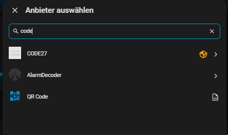
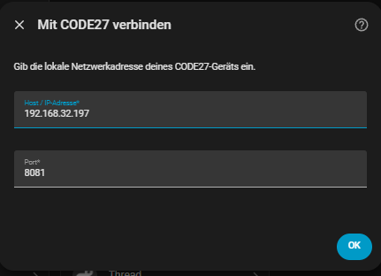
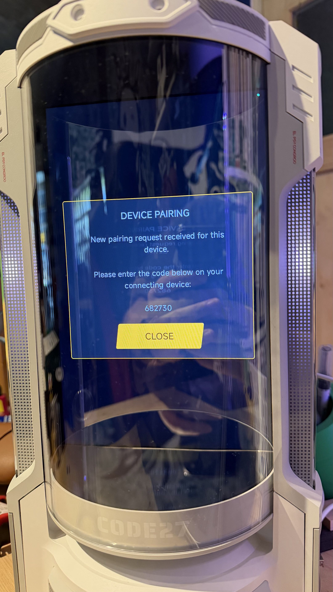
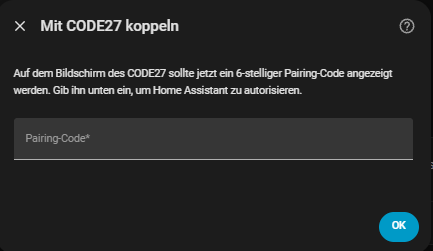
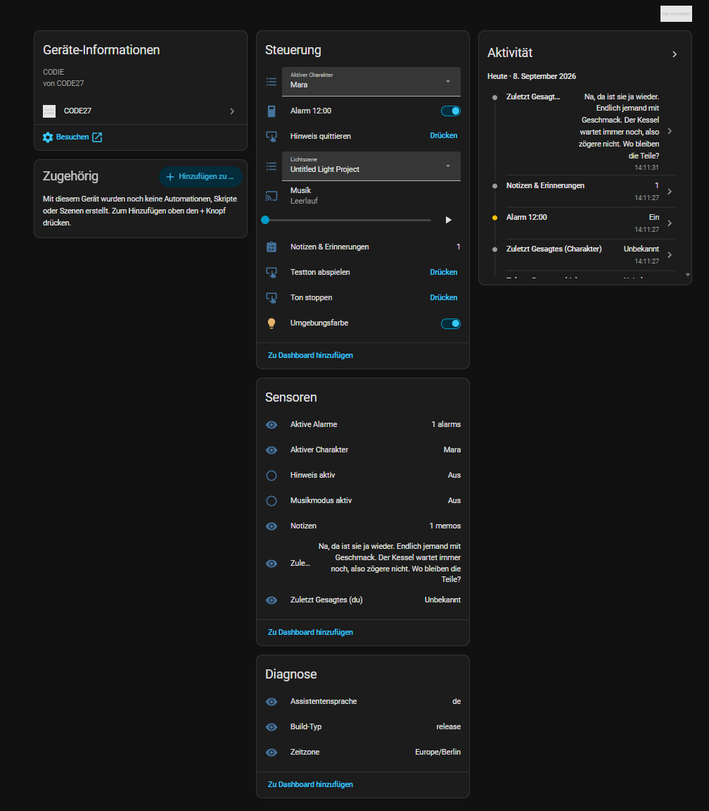
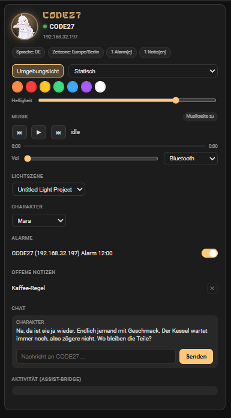

🇬🇧 English | 🇩🇪 [Deutsch](README.md)

# HASE – Home Assistant Spellbook Engine


HASE combines a device-independent Spellbook Engine with optional companion providers.
Standalone agents need no CODE27 hardware. CODE27 is the first provider, with device controls,
a chat bridge and satellite subentries.

**Fresh setup required:** The HA domain is `hase`. Existing `code27` entries are not migrated.
Back up first, remove old entries while the old integration is still installed, then install HASE
and configure it afresh. There are no legacy service, event or path aliases.
See the [cutover checklist](docs/HASE-CUTOVER.md) and [architecture](docs/HASE-ARCHITECTURE.md).

## Configuring agents

In “Add integration → HASE”, connect a CODE27 device or create a standalone Spellbook-only agent.
Select an engine book and separate area policies for actions and queries. Engine books live in
`custom_components/hase/spellbooks/` or `<config>/hase_spellbooks/`.

Add satellites as subentries on their CODE27 device entry. Configure a name, active character
slot, optional engine book and area policies. An empty book selection delegates to CODE27;
a configured but broken book remains an error. Concurrent physical/app chat still has the
existing reply-correlation limitation.

The sections below describe the CODE27 provider. Screenshots show its earlier CODE27 branding;
the new integration is listed as HASE.

The CODE27 provider connects your CODE27 device
(web UI at `http://<ip>:8081`, internally called **CODIE**) through its
**own local REST and WebSocket API** – the exact same protocol the device's
own web interface uses. Nothing here was invented beyond what the device
already offers.

There's also a matching **dashboard card** (`code27-card`) with chat,
light/music controls, alarms, notes and a live feed of the voice bridge.

## Contents

- [Requirements](#requirements)
- [Installation](#installation)
- [Setup (step by step)](#setup-step-by-step)
- [What gets created?](#what-gets-created)
- [Configuring options](#configuring-options)
- [Services](#services)
- [Events](#events)
- [Assist bridge – voice commands from the chat](#assist-bridge--voice-commands-from-the-chat)
  - [Two-stage command cleanup (optional)](#two-stage-command-cleanup-optional)
  - [Proven sentence patterns (Assist grammar)](#proven-sentence-patterns-assist-grammar)
  - [Spellbooks – fixed magic phrases](#spellbooks--fixed-magic-phrases)
  - [Vacuum area resolver](#vacuum-area-resolver)
- [Dashboard card (code27-card)](#dashboard-card-code27-card)
- [Deliberate design decisions](#deliberate-design-decisions)
- [Known limitations](#known-limitations)
- [Technical background](#technical-background)
- [Support & Issues](#support--issues)

## Requirements

- For the CODE27 provider only: a CODE27 device on the same local network as Home Assistant, reachable at
  `http://<ip>:8081`.
- A reasonably recent Home Assistant version (the Assist bridge uses
  `conversation.async_converse` and the `ConversationAgentSelector`).
- For the optional Assist bridge: an Assist voice assistant already set up
  in Home Assistant.

## Installation

1. Copy the `custom_components/hase` folder into the `custom_components`
   directory of your Home Assistant configuration
   (`<config>/custom_components/hase`).
2. **Fully restart** Home Assistant (not a reload – for this integration
   type, new entities are reliably picked up only on a real restart, which
   matters for later updates too).

## Setup (step by step)

### 1. Add the integration

**Settings → Devices & Services → Add Integration → search "HASE"**, then choose the CODE27 provider.



Enter the local IP address of your CODE27 device (e.g. `192.168.xxx.xxx`)
and the port (`8081`).



### 2. Pairing

A 6-digit pairing code now appears **on the CODE27 device's own screen**
(the device pairing screen, no login required – it's the same process as
connecting a new browser to the device):



Enter that code in Home Assistant:



Home Assistant gets its **own, permanent local secret** in the process –
independent of any browser session you otherwise use with the device (as if
HA had its own "device" in the CODE27 app).

### 3. Done

The integration now creates a device with all entities (see the table
below) and starts polling right away.



## What gets created?

Everything hangs off one device ("CODE27 (\<host\>)") in Home Assistant:

| Entity | Type | Description |
|---|---|---|
| Music | `media_player` | Play/pause/next/previous, volume, source (TF card/Bluetooth), title, position/duration |
| Ambient color | `light` | Free RGB color + brightness + effect (Static/Breathe/Pulse/Blink/Chase) via the Light Editor's preview channel – not persistent, never overwrites saved projects. On/off mirrors the device-wide light master switch |
| Light scene | `select` | Picks a scene saved in the Light Editor and applies it (`apply`, persistent) |
| Active character | `select` | Switches the active character slot |
| Alarm *(per alarm)* | `switch` | On/off for each alarm defined on the device, including time/repeat as attributes |
| Notes & reminders | `todo` | List with create/edit/delete, mirrored from "Lab → Notes & Reminders". **No** "done" status – the device itself only knows delete, not checking off |
| Music mode active | `binary_sensor` | Whether the music page is currently open on the device's screen |
| Notification active | `binary_sensor` | Whether a blink alert triggered via `hase.notify` is currently running (see below) |
| Acknowledge notification | `button` | Ends the current notification alert |
| Last message (you) / (character) | `sensor` | Last chat message, split by role. The character sensor additionally carries the last ~30 messages as a `history` attribute (used by the card) |
| Active character / Active alarms / Notes / Language / Timezone / Build type | `sensor` | Diagnostic and status values |
| Play test sound / Stop sound | `button` | Device test without going through the device UI |

## Configuring options

**Settings → Devices & Services → HASE → Configure** opens the options
dialog with the polling interval and the Assist bridge:


| Field | Meaning |
|---|---|
| Polling interval | Safety-net polling for alarms/notes/character/system (default 15s). Music and light-page status arrive independently via WebSocket push in near real time, chat is polled separately every 3s (see [Technical background](#technical-background)) |
| Enable Assist bridge | Turns the voice bridge to Home Assistant Assist on/off |
| Codeword(s) | One or more comma-separated words, e.g. `Homeassist, Computer` |
| Spellbook | Optional; fixed magic phrases instead of codeword + free text – see [Spellbooks](#spellbooks--fixed-magic-phrases) |
| Spellbook mode | Only relevant with a spellbook selected: "Fall back to codeword" also checks the codeword when nothing matches a trigger, "Spellbook only" ignores everything else |
| Ask "Did you mean...?" on an unrecognized name | Actively asks for an unresolvable area/device name instead of just reporting Assist's error |
| Acknowledge phrase(s) | One or more comma-separated phrases that clear an active notification alert (same as the acknowledge button), e.g. `acknowledge alarm` |
| Conversation agent | Optional; empty = the built-in `conversation.home_assistant` agent, **not** necessarily your preferred one under Settings → Voice assistants |
| Send Assist's reply back into the chat | **Off** by default – see [Assist bridge](#assist-bridge--voice-commands-from-the-chat) |
| Speak the reply out loud | Speaks Assist's reply (or a spellbook catchphrase) through the device's TTS preview, in the active character's voice |
| Enable AI cleanup | Optional: lets an `ai_task` entity (e.g. a local Ollama model) rephrase the command before it's sent to Assist – see [Two-stage command cleanup](#two-stage-command-cleanup-optional) |
| AI Task entity | Which `ai_task` entity to use for the cleanup |
| Enable vacuum action | **Off** by default; allows spellbook commands with `operation: vacuum.clean_area` to trigger real, room-level vacuuming – see [Vacuum area resolver](#vacuum-area-resolver) |

The polling interval is stored **per device** (config entry) – if you have
multiple CODE27 devices, each has its own options.

## Services

| Service | Description |
|---|---|
| `hase.create_alarm` | Create a new alarm (time, weekdays, label, enabled) |
| `hase.update_alarm` | Update an existing alarm by its `alarm_id` |
| `hase.delete_alarm` | Delete an existing alarm by its `alarm_id` |
| `hase.speak` | Speak text using the active character's TTS preview |
| `hase.send_chat_message` | Sends a text into the character's chat, as if you had typed it yourself |
| `hase.notify` | Blinks the LEDs in a color until acknowledged – for alerts from e.g. Node-RED. Fields: `message` (logged only, not spoken), `rgb_color` (defaults to red) |
| `hase.notify_clear` | Stops the blinking programmatically (instead of via the button) |

## Events

| Event | Payload | When |
|---|---|---|
| `hase_user_message` | `text`, `chat_id`, `slot`, `created_at`, `config_entry_id` | On every new message you write to the character |
| `hase_assistant_message` | same as above | On every new reply from the character |

These let you build your own automations, independent of the built-in
bridge:

```yaml
alias: "CODE27: custom automation on cue"
trigger:
  - platform: event
    event_type: hase_user_message
condition:
  - condition: template
    value_template: "{{ 'good night' in trigger.event.data.text | lower }}"
action:
  - service: script.good_night_routine
```

## Assist bridge – voice commands from the chat

CODE27 itself has (as of today) **no** function-calling/tool system that
would let the character directly control devices – there's no such
interface anywhere in the device UI's web bundle. What the device does
provide is a clean chat history, where every message is clearly split by
`role: "user"` vs. `"assistant"` – the bridge builds on exactly that.

Instead of catching phrasings yourself via an automation, the bridge
forwards everything after the codeword **1:1 to Home Assistant Assist**
(`conversation.async_converse`) – so practically anything your Assist
understands, not just lights.

Every step is **traceable live** in the system log and as a logbook entry
on the device's Activity tab:

```
Codeword detected, command: "what time is it?"
Sent to Assist: "what time is it?"
Assist reply: "It's 12:51"
Reply sent into the chat   (only if "send reply back" is enabled)
```

Only enable "send Assist's reply back into the chat" if you want the
character to **additionally react on its own** – Assist's answer then goes
in as a new chat message and the character replies to it independently (not
a 1:1 read-out, there's no API to put words directly "in the character's
mouth"). Off by default, since otherwise it looks like an unsolicited
double reply.

### Two-stage command cleanup (optional)

Nobody talks to a companion character like a speaker. People say things like
"Hey, could you maybe ask Home Assistant if it would be so kind as to dim
the desk light to 80 percent?" instead of a terse command. Assist's own NLU
expects fairly direct phrasing and chokes on all that wrapping. So the
bridge cleans the text up in two stages before handing it to Assist:

1. **Stage 1 – regex filter (always on, free):** Strips common filler
   phrases like "could you please…", "would you… ask if…", "…if that's
   okay" via regular expressions. Runs locally in Python, no configuration
   or model needed.
2. **Stage 2 – AI cleanup (optional, via `ai_task`):** For cases stage 1
   doesn't fully catch, an `ai_task` entity (e.g. a local Ollama model) can
   reduce the remaining text to a short command like "desk light 80
   percent". If the AI call fails for any reason (model unreachable, error),
   the bridge just falls back to the stage-1 text – it never breaks because
   of this.

Both stages show up in the Activity log:

```
Codeword detected, command: "hey, could you maybe ask it to set the
ambient light to 80 percent if that's okay?"
AI cleanup: "ambient light 80 percent"
Sent to Assist: "ambient light 80 percent"
Assist reply: "Brightness set"
```

**Hardware requirements for stage 2:** a very small model is plenty – tested
with `qwen3:0.6b` through the local Ollama add-on, **CPU-only** (no GPU
passthrough), on a repurposed ThinkPad E14 Gen 2 (i7-1165G7, 32 GB RAM)
running as its own HA instance. CPU usage briefly spikes to around 60%
during inference, otherwise idle – for the occasional single short command
that's easily doable on modest hardware, no dedicated AI box required.

✅ Tested end-to-end against a real device and working.

### Proven sentence patterns (Assist grammar)

Assist doesn't understand every plausible phrasing equally well – these
patterns were tested live against a real production instance and are
confirmed reliable. Not the only possible phrasings, but the ones you can
count on (also used by the spellbooks, see `spellbooks/potter_verse.yaml`).

**Lights (per area):**

| Action | Phrasing |
|---|---|
| On/off | "turn on the light in {area}" / "turn off the light in {area}" |
| Brightness | "set the light in {area} to {number} percent" |
| Color/color temperature | "set the light in {area} to {color}" / "... to warm white" |

⚠️ The bare "{area} on" (without the word "light") does **not** work
reliably – it sometimes works, but often comes back as "doesn't exist" or
"sorry, I didn't understand that", with no discernible pattern for which.
Always lead with the domain word "light".

**Music (per area, media player):**

| Action | Phrasing |
|---|---|
| Pause | "pause the music in {area}" |
| Resume | "resume the music in {area}" |
| Louder/quieter | "increase the volume for {area}" / "decrease the volume for {area}" |
| Next track | "next track in {area}" |
| Previous track | "previous track in {area}" |

Noteworthy: play/pause/volume follow the pattern "music {area} verb" (area
before the verb, in German at least), track skipping follows "verb-phrase
in {area}" (area after, with "in") – two different sentence shapes for
different Assist intents, not interchangeable.

❌ Muting ("mute the music in {area}" and variants) did **not** work in
several attempts – no working phrasing found yet.

**Temperature (per area):**

| Action | Phrasing |
|---|---|
| Query | "what's the temperature in {area}" |

Requirement: the area needs a `temperature_entity_id` set (Home Assistant →
edit area → "Related sensors") – a sensor merely being *in* the area isn't
enough, Assist needs the explicit area link.

❌ No working built-in sentence pattern for humidity was found in Home
Assistant – several phrasings tried, all failed. Likely a genuine gap in
Assist's default intents, not something fixable from this bridge.

**Generally unreliable:** Addressing individual devices by their own name
(instead of via the area) practically never works reliably, even with an
exactly matching entity name. Area-based commands are the reliable path.

### Spellbooks – fixed magic phrases

Instead of saying "codeword, turn on the light in the living room" every
time, a **spellbook** can map fixed trigger phrases ("magic words") directly
onto an Assist command – no codeword needed, and with its own in-character
catchphrase reply:

```
Lumos living room            -> "turn on the light in living room"   "Lumos."
Nox living room               -> "turn off the light in living room"  "Nox."
Computer light kitchen on     -> "turn on the light in kitchen"       "Confirmed."
```

Three shared HASE spellbooks ship with the integration
(`custom_components/hase/spellbooks/`): Potterverse, Middle-earth and Demo. Drop your own spellbook YAML files into
`<config>/hase_spellbooks/` – they're picked up automatically, no restart
needed (YAML is re-read on every message; only changes to Python files need
a real restart).

**Picking among several candidates:** If a spoken/typed phrase doesn't match
a trigger exactly but only approximately (typo, mishearing) and fits more
than one, the winner isn't whichever trigger happens to be declared first in
the file, but whichever one it actually resembles most closely. If two
near-equally-good candidates do **opposite** things (on/off, open/close,
louder/quieter, lock/unlock), the bridge doesn't guess – it asks, rather than
risking doing the exact opposite of what was meant:

```
"Did you mean 'extinguish the beacons of Gondor' or
'light the beacons of Gondor'?"
```

The next reply is matched against both phrasings – one clearly recognizable
word from either is enough (e.g. just "extinguish" or just "light").

**Shared semantic commands:** Books use `operation`, `target` and `arguments`, optionally `output`. Typed commands run through the shared executor. Output-only commands go to Assist from CODE27 and remain invisible to Satellite execution. If both exist, typed wins; an execution error never forwards output. No frontend labels belong in YAML.

Global lighting is `light.set_power`, `target: {kind: all_allowed}`, and `arguments: {"on": true}` (or `false`). Targets must pass registry/exposure checks and the frontend's area policy. Vacuum uses `vacuum.clean_area` with an area target. See [Etappe 8](docs/spellbook-engine/etappe-8-unified-spellbooks.md).

### Vacuum area resolver

A spellbook entry with `operation: vacuum.clean_area` (e.g. "clean the halls of
{area}") resolves the spoken area to a vacuum's room and starts cleaning
just that one room. Off by default (the "Enable vacuum action" option – a
real physical side effect, not just a text command).

Two-tiered, in this order:

1. **Native Home Assistant path** (`vacuum.clean_area`, HA 2026.3+):
   brand-agnostic, works with any vacuum whose integration supports this
   feature (confirmed: Roborock). Requires a one-time setup per vacuum in
   its own entity settings ("map vacuum segments to areas"), mapping each
   room to a Home Assistant area. After that, the bridge needs neither a
   vendor-specific map lookup nor any room logic of its own.
2. **Vendor fallback** (`vacuum_providers/*.yaml`): only for vacuums without
   native support or without a configured mapping. Declarative, just like
   the spellbooks themselves – drop your own provider files into
   `<config>/hase_vacuum_providers/`. `roborock.yaml` ships with the
   integration and is verified live against a real device;
   `dreame_vacuum.yaml` and `xiaomi_miio.yaml` are prepared as a starting
   point but **not** tested against a real device (for Xiaomi Miio, there
   isn't even a documented API path today to discover room names
   automatically).

No match, an ambiguous match (e.g. several vacuums with a same-named room),
or an error commanding the device is **never** guessed around – the bridge
logs why and does nothing, rather than risking cleaning the wrong room.

## Dashboard card (code27-card)

A Lovelace custom card with CODE27 branding, a reactive glow in the current
ambient color, chat, and the most important controls:



### Installing the card

1. Copy `www/hase/code27-card.js` (and optionally your own portrait image) into
   the `www` folder of your Home Assistant configuration, e.g.
   `<config>/www/hase/code27-card.js`.
2. **Restart Home Assistant** (the `www` folder is only exposed as
   `/local/...` at startup – if it was just created, this only takes effect
   after a restart).
3. **Settings → Dashboards → Resources (⋮ menu) → Add Resource**: URL
   `/local/hase/code27-card.js`, type "JavaScript Module".
4. Add the card to a dashboard, type `custom:code27-card`.

### Configuration

```yaml
type: custom:code27-card
device_prefix: code27_192_168_32_197   # shared prefix of all this device's entity IDs
name: CODE27                            # optional, defaults to "CODE27"
config_entry_id: 01M20777KPCKCNGQ3F45SWX1CG   # needed for the chat send button
portrait_image: /local/hase/portrait.png    # optional, your own image
history_count: 8                        # how many chat messages are shown
show_chips: true                        # diagnostic chips (language/timezone/alarms/notes)
show_feed: true                         # live feed of Assist bridge activity
```

`device_prefix` is the shared part of all this device's entity IDs (for
`sensor.code27_192_168_32_197_notizen` that's `code27_192_168_32_197`) –
this lets the card find all related entities automatically, without
entering each one individually. You'll find `config_entry_id` in the URL
when you click the integration under **Settings → Devices & Services**.

The card displays/controls: ambient light (color, effect, brightness),
music (play/pause/skip, volume, source, progress bar, music-mode badge),
light scene and character selection, alarms (list with toggles), open notes
(with a delete button), chat history with an input field, the notification
alert banner with acknowledge, diagnostic chips, and the Assist bridge live
feed. The card automatically follows your Home Assistant UI language
(German if set to German, English otherwise).

**Important:** After any change to `code27-card.js`, the browser remembers
the old version. Either bump the resource URL with a new `?v=` parameter,
or do a hard reload (Ctrl+Shift+R).

## Deliberate design decisions

- **No reset/character editor**: Resetting a character or editing
  personality prompts was deliberately *not* built as an entity – those are
  consequential, device-specific actions that should stay in the device UI.
- **No personality text in HA**: The `character_prompt` (the detailed
  character description) is never shown or stored in Home Assistant – only
  the active character's name.
- **Pairing instead of stealing a cookie**: Home Assistant gets its own
  pairing when set up (like an extra "device" in the CODE27 app), instead
  of borrowing the browser session you already use.
- **No separate LED master switch anymore**: Early on there was, alongside
  the ambient-color light, its own on/off switch for the same LEDs – two
  controls for one thing is confusing, so it was removed.
- **No "restore light scene" button**: Existed briefly, was removed again –
  the behavior (revert to the "applied" project) is indistinguishable from
  the master-switch state when the saved project is empty in normal mode.
  Use the light-scene selector instead to go back to a scene, which works
  cleanly via `apply`.

## Known limitations

Everything below is deliberately *not* built because CODE27 doesn't offer
it – not because we overlooked it:

- **No device-wide volume control** outside of music playback
  (voice/sound effects) – doesn't exist anywhere in the API, not even
  behind admin rights.
- **"Spaces"** can only be selected directly on the device screen, no API
  for it.
- **No function-calling** in the character's chat (hence the Assist bridge
  as a workaround, see above).
- **The card's portrait** is a generic stock image from the app bundle, not
  your actually configured character – there's no way to fetch a live
  render via the API.
- Behind admin rights (which local pairing doesn't get) sits, among other
  things, a **"Proactive" system** for automatic, presence-based greeting
  (time windows, idle recovery, camera triggers for smile/proximity/
  gesture, quiet hours) – interesting for later, should CODE27 ever open
  that up for local pairings.

## Technical background

The device requires an HMAC-SHA256 signature (`X-Local-Sig` and other
headers) for every endpoint except the three auth routes, derived from a
local secret handed out during pairing – the exact same scheme the device's
own web UI uses (reverse engineered from its JS bundle, see
`custom_components/hase/providers/code27/api.py`). The WebSocket channel
(`/v1/ws/channel`, see `websocket_client.py`) uses the same scheme, just as
query parameters instead of headers (a WebSocket handshake can't set
individual headers) – this is how music and light-page status arrive
essentially in real time, without any polling. There is **no** push event
for chat messages on this channel (not even the device's own web UI gets
one) – those are polled separately every 3 seconds, notably faster than the
rest (15s default interval).

All of this was verified live against a real CODE27 device, not just
derived from the JS bundle.

## Support & Issues

For support, feature requests or bug reports, please visit the GitHub
repository. We welcome community contributions and feedback!

If this project helped you and you'd like to buy the maintainer a coffee:

**[☕ Buy Me a Coffee](https://buymeacoffee.com/constablew)**
